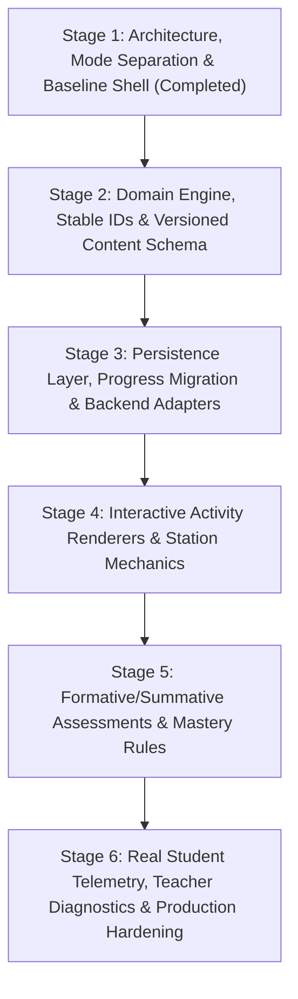

# 02 — Dependency-Ordered Implementation Plan («رحلة الهضم»)

This plan orders all engineering and instructional design work strictly by technical and pedagogical dependency. Each stage produces a verified, runnable increment.

---

## Stage 1: Foundation, Mode Separation & Baseline Verification (Current Stage)
**Dependencies:** None (Root stage)
1. Initialize React + TypeScript + Vite project with strict type checking and RTL Arabic layout (`dir="rtl" lang="ar"`).
2. Create environment configuration (`src/config/env.ts` and `.env.example`) enforcing strict runtime separation between **Local Demo Mode** (`demo`) and **Production Mode** (`production`).
3. Establish clean directory separation:
   - `src/domain/` (stable IDs, core entities, pure progression/scoring rules)
   - `src/content/` (presentation-independent curriculum schema & manifest)
   - `src/persistence/` (storage port & versioned local storage adapter with mode-isolated namespaces)
   - `src/backend/` (backend port, demo sandbox adapter, and honest production API adapter)
   - `src/activities/` (pluggable activity renderer registry)
   - `src/ui/` (RTL layout shell, mode banner, student session manager, dependency inspector)
4. Record all unresolved content, asset, and configuration dependencies in `src/config/unresolvedDependencies.ts`.
5. Build and run the baseline application to verify zero compilation or runtime errors.

---

## Stage 2: Authoritative Curriculum Content & Domain Rules Expansion
**Dependencies:** Stage 1 (`src/domain/ids.ts`, `src/content/schema.ts`)
1. Expand the 6th-grade «رحلة الهضم» curriculum manifest with complete station learning objectives, scientific vocabulary cards, misconception remediations, and activity blueprints as specified in subsequent prompts.
2. Implement content-version migration helpers so student progress recorded against `content-ar-g6-digestion-v1.0.0` is preserved if content items are updated.
3. Enforce schema validation on all curriculum structures prior to rendering.

---

## Stage 3: Persistence, Offline Queue & Backend Integration
**Dependencies:** Stage 2
1. Implement durable attempt logging (`AttemptId` linked to `StudentId`, `ContentVersionId`, `LevelId`, `ActivityId`).
2. Add an offline-first synchronization queue in `src/persistence/` that buffers attempts locally and syncs to `BackendPort` when `VITE_API_BASE_URL` is reachable in Production Mode.
3. Provide JSON export/import of real student progress for classroom backup without mixing demo and production namespaces.

---

## Stage 4: Pluggable Activity Renderers (Interactive Stations)
**Dependencies:** Stage 2 & Stage 3
1. Build pure, state-driven interactive activity renderers in `src/activities/`:
   - **Concept Check (`concept_check`):** Evidence-based multiple-choice with targeted scientific feedback.
   - **Pathway Ordering (`pathway_order`):** Sequencing organs of the digestive tract from ingestion to elimination.
   - **Organ-Function Matching (`organ_matching`):** Pairing digestive organs and accessory glands with their mechanical/chemical roles and enzymes.
   - **Interactive Simulation / Labeling (`anatomical_labeling`):** Contingent on approved SVG/diagram assets (`DEP-ASSET-001`).
2. Ensure every control is functional and stateful—no decorative buttons or simulated success states.

---

## Stage 5: Mastery Calculation, Level Unlocking & Summative Assessment
**Dependencies:** Stage 4
1. Connect station completion and mastery thresholds (`src/domain/rules.ts`) to sequential station unlocking.
2. Implement remedial review loops when a student falls below the station mastery threshold.
3. Add a comprehensive end-of-journey summative assessment with itemized skill breakdown.

---

## Stage 6: Honest Analytics, Accessibility & Production Hardening
**Dependencies:** Stage 5
1. Build a student/teacher progress report view displaying **only real recorded attempts** (zero fake students, zero fabricated leaderboards, zero synthetic analytics).
2. Conduct full RTL keyboard navigation, ARIA live-region announcements in Arabic, and responsive tablet/desktop classroom testing.
